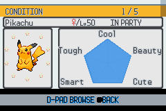
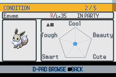
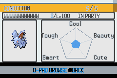
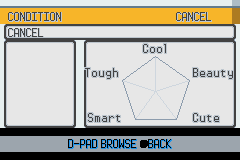
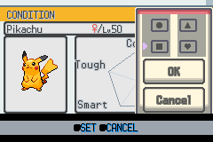
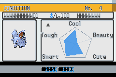
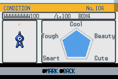

# HGSS Condition details — visual acceptance

Completed on 2026-11-04 for `feature/gen4-ui-renderer`. This covers the
Condition **detail graph**, entered from either the party or search results:
metadata, chart, portraits, sheen, markings, Cancel and return paths.

## Original artwork and layout

HGSS has no PokéNav Condition screen. The adapter uses the verified retail
summary header and party-card cells, HGSS font ID 4 for the five chart labels,
the original Summary star for sheen, and the original Storage markings panel.
The [source manifest](../../graphics/gen4_ui/hgss_condition/source.json)
links all inputs to their existing archive/member records and output hashes.
`make_hgss_condition_graph.py --check` reconstructs every output byte.

No artwork is scaled or repainted. The chart's reference pentagon and axes
are mathematical guides, explicitly distinguished from retail artwork.
The existing condition renderer still calculates and animates the live
polygon from the Pokémon's five values. Its blue fill uses original summary
palette index 9, with the existing scanline windows and alpha blend.

| Area | Native layout |
|---|---|
| Title / index | y=8–23; party position or three-digit search rank |
| Name / gender / level / location | y=24–39; 96-pixel name field and level 100 |
| Portrait | 64×64 centered at (40,80) in the original card |
| Sheen | Original 8×8 star, seven blink frames; all ten positions inside the card |
| Chart | Existing center (155,91), all five labels above the help bar |
| Saved markings | Four original 8×8 symbols at (88,48) |
| Markings popup | Original 88×120 panel at (152,8); original HGSS cursor |
| Shared help bar | y=128–159; party BROWSE/BACK, search MARK/BACK, popup SET/CANCEL |

BG1 owns transparent text and the popup; BG2 is the scanline-clipped data
fill; BG3 holds the verified background. BG1's popup uses the same tilemap
buffer allocated by `AddWindow`, so window updates cannot hide it.
`check_hgss_condition_graph.py` proves that all maps, window tiles, popup
tiles and shared BG0 resources occupy separate VRAM regions.

## Reviewed native framebuffer captures

These unscaled 240×160 frames were captured through real PokéNav input in
mGBA, not assembled from an offline mockup.

## Reproducible acceptance

The [Condition detail workflow](../../.github/workflows/hgss-condition-graph.yml)
validates production assets, injects a disposable synthetic save, builds the
ROM, then drives a pinned headless mGBA utility. Only screenshots are uploaded.
No fixture startup code, ROM or save is committed.

The normal fixture has five valid party Pokémon with an egg between the
fourth and fifth, twenty valid PC Pokémon and another high-stat egg in
storage. It includes zero/max/asymmetric condition values, maximum sheen,
all gender cases, twelve-character nicknames, level 100 and an eight-character
box name. Separate cold boots exercise one party Pokémon, an empty party,
and 104 search results across four PC boxes.

The verifier checks **43 settled detail/markings states**, comparing
16,792 background/text pixels per normal detail frame and 21,632 per popup
frame against the source tiles and font glyphs. RGB555 expansion permits
at most eight units per color channel. Only animated portraits/stars and
the popup pointer footprint are excluded from that comparison; these were
also inspected visually. The live polygon is independently rasterized from
fixture condition values, allowing two pixels only at scanline boundaries.

| Coverage | Accepted behavior |
|---|---|
| Party browsing / egg gap | Correct valid-mon count and metadata; egg skipped |
| First / last / Cancel wrapping | Correct portrait and text; Cancel clears the data polygon |
| Party A and B | A ignored on a Pokémon; A on Cancel and B return correctly |
| Single and empty party | Cancel remains usable; Up/Down cannot load an empty portrait |
| Search first / rank 104 | Selection clamps at each end; rank and location remain correct |
| Zero / max / asymmetric condition | Filled polygon follows all five values |
| Maximum sheen | All ten positions display the original unscaled star across 32 captures |
| Four markings | Visual circle/triangle/square/heart map to saved bits 0/2/1/3 |
| OK / B / Cancel | OK persists edits; B and Cancel discard pending changes |
| Party / PC marking persistence | Marks survive changing Pokémon and full screen re-entry |
| Popup close | Restores text, polygon and the MARK/BACK help bar |
| Six exit paths | Return to the real Condition menu or selected search result |

The existing **34-state Condition search suite** also passes with the new
detail renderer; its two graph checks now verify the actual condition values
instead of looking for the retired green fill. The 60 existing HGSS ribbon
Python regressions and source-asset validation pass as well.

## Legacy removal and shared ownership

After live acceptance, the old detail-only `graph_data.png`, `graph_data.bin`
and `mon_markings.pal` are removed. The live screen no longer binds procedural
frames, the old party Pokéball rail, hidden bottom Cancel graphic, generic
markings-menu art, or old sheen sprites.

Pokéblock feeding still uses `graph_data.pal`, `text.pal`, the generic
selection icons and their animation. Its two palette definitions now live
in `use_pokeblock.c`; those shared files and feeding behavior are retained.
The Condition detail's sheen positioning is local to this screen.
