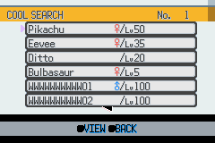
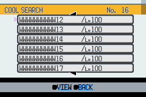
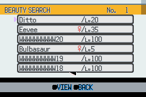
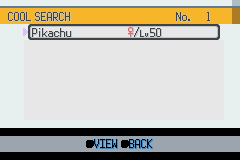
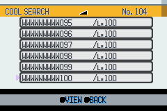

# HGSS Condition search results — visual acceptance

Completed on 2026-11-04 for `feature/gen4-ui-renderer`. This covers the
PokéNav Condition search **results list** for Cool, Beauty, Cute, Smart and
Tough, including entry, scrolling, rank updates and return paths.

## Original artwork and live layout

HGSS has no PokéNav Condition search list. This screen adapts the original
HGSS summary header and party-card cells already verified for the ribbon
owner list. The source chain is recorded in
[`summary_bg.source.json`](../../graphics/gen4_ui/hgss_ribbons/summary_bg.source.json)
and [`owner_list/source.json`](../../graphics/gen4_ui/hgss_ribbons/owner_list/source.json).
There is no scaling, repainting, recoloring or duplicate asset set.

The live renderer uses `summary_bg.4bpp`, its original palette banks 1 and 7,
and the lossless `owner_list/background.bin` / `row.4bpp` adaptations.
Six 200×16 rows occupy x=24–223, y=24–119, above the shared help bar.
BG1 masks the scrolling BG2 rows; transparent title/rank text uses BG3.
The validator checks all three tilemaps, window tiles and the full circular
row buffer for VRAM overlap. Both palettes reload on every entry.

The header identifies the selected category and preserves competition
ranking: two Pokémon tied for first are followed by rank three. Rows show
the actual nickname, gender and level. A 96-pixel name field accommodates
the expansion's twelve-character names; the level field fits level 100.

## Reviewed native framebuffer captures

These unscaled 240×160 frames come from real mGBA navigation through the
PokéNav main menu, Condition menu, category menu and result/detail screens.

## Reproducible acceptance

The [Condition search screenshot workflow](../../.github/workflows/hgss-condition-search.yml)
first validates production assets, then patches a disposable checkout with
a synthetic save. It uploads screenshots only, never that fixture ROM/save.
Storage is initialized as for a new save, including terminated box names.
The normal startup callback and runtime source are not changed by the fixture
in the production commit.

The fixture has four party Pokémon, twenty boxed Pokémon with distinct
twelve-character names and level 100, and high-stat eggs in both the party
and PC that must be excluded. One boxed Pokémon is male, so all three gender
cases are checked. Each category has different condition values. Later entries
remove synthetic box/party records to exercise four-result and one-result
lists through the same runtime code. A second cold boot with R held creates
104 valid results across four PC boxes, exercising three-digit ranks and
12-character names ending in three digits.

`verify_hgss_condition_search_screens.py` compares **26,544 pixels in each
of 34 settled list states** against original HGSS panels and the game's
actual font glyphs. It computes the expected category ordering and tied
ranks from the fixture data independently of the runtime. RGB555 expansion
allows a maximum channel difference of eight. Only the animated pointer
footprints are excluded; these were reviewed visually. Every results frame
also restores the same VIEW/BACK footer, and both detail transitions must
render a filled condition polygon.

| Coverage | Accepted behavior |
|---|---|
| All five categories | Correct title, sorted names, and first/second/third ranks |
| Tied leaders and high-stat party/PC eggs | Ranks 1, 1, 3; both eggs absent |
| Male, female and genderless Pokémon | Original palette indices and correct symbols |
| 104-result list across PC boxes | Ranks 104 and 103 fit; final page clamps correctly |
| First, second, fourth and last pages | Correct rows, names, levels and rank |
| First/last-result boundaries | Up/Down leave boundary selections unchanged |
| Upward circular-buffer wrap | No stale row text or header bleed |
| PC detail screen and return | Same selected result, rank and panel colors |
| Page-up and main-menu re-entry | First result restored correctly |
| Four-result and one-result lists | Unused rows clear; page and Up/Down boundaries hold |
| Single-result detail round trip | Selection and original colors preserved |

## Legacy removal

After live acceptance and a reference audit, the old
`graphics/pokenav/condition/search_results.png`, `search_results.bin` and
`search_results_list.pal` are removed. The procedural rank-card and row
borders are removed from the live renderer. Existing authenticated HGSS
list pointers, scroll controls and shared help bar remain in use.

The Condition graph has its own completed
[visual acceptance](hgss_condition_graph_visual_qa.md). Its entry/return
behavior is also exercised here because it is part of using the results list.
