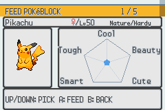
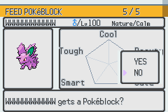
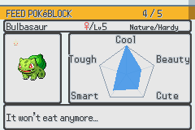
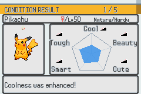
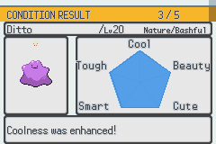
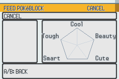

# HGSS Pokéblock recipient and results — visual acceptance

The entire recipient/results screen follows **authentic HGSS asset → wire live
→ remove legacy**. Party browsing, Cancel, nature/name/gender/level, Yes/No,
maximum-sheen refusal, pre/post feeding conditions and enhancement messages use
the same layout. The real case menu and feeding animation remain the entry,
intermediate scene and return target.

## Original assets and live layout

The background, header and chart labels reuse the verified Condition detail
assets. Its reference pentagon is mathematical data visualization; the game
continues to draw the actual data polygon through its scanline renderer.
`make_hgss_pokeblock_use.py` copies complete native HGSS summary party-card
corners, edges and interior cells into the footer and confirmation panel.
There is no scaling, repainting or invented palette. The manifest records the
source digest and exact outputs.

The confirmation pointer and five result arrows use the verified HGSS Pokédex
list-arrow sheet. Sheen uses the original 8 × 8 summary star. Condition detail
and feeding share its loader and ten positions inside the portrait card.

| Region | Position / allocation |
| --- | --- |
| Title and party index | y=8; BG0 text |
| Name, gender/level and nature | y=24; nature uses the small font |
| Portrait | (40,80), 64 × 64, inside the native card |
| Condition graph | Original engine coordinates, above y=128 |
| Prompts and result messages | 240 × 32 footer at y=128 |
| Yes/No | 64 × 48 original card at (168,72) |
| BG maps | Screen blocks 4, 5, 6 |
| Text / background / polygon tiles | Character blocks 1 / 2 / 3 |

The title and prompts use ordinary readable text. Cancel clears the portrait,
metadata and polygon; a full six-mon party no longer reads `party[6]` while
preloading Cancel. Egg-only parties ignore Up/Down safely. Yes/No temporarily
hides the data fill and restores it on either dismissal. Result arrows retain
their original pixels, use a small bob that clears labels, and are tracked for
cleanup on exit.

## Native captures

These are actual 240 × 160 mGBA frames, not mockups.








## Reproducible acceptance

The [dedicated workflow](../../.github/workflows/hgss-pokeblock-use.yml) builds a
disposable startup fixture, follows the actual case → Use → recipient →
feeding animation → results → case route with pinned headless mGBA, and checks
62 recipient/prompt/result states. Every static panel, text and arrow pixel is
compared to its source, allowing only RGB555 display rounding. The data polygon
is independently reconstructed from fixture stats with a two-pixel scanline
boundary allowance. Animated portraits are excluded from chrome comparison;
all ten native sheen positions are checked across 32 frames.

| Real route | Verified result |
| --- | --- |
| Five eligible mons plus one egg | Egg omitted; both wrap directions; genderless and 12-character names |
| One, six and egg-only parties | Correct indices, visible Cancel, no stale portrait/polygon, real return |
| Yes/No and B | Original pointer positions; No/B restore browse text |
| Maximum sheen | Refusal; stats and item count unchanged |
| Neutral White block | Stats 0 → 20/30/40/50/60; sheen 0 → 40 |
| Liked Red block, Adamant | Cool 60 → 126; sheen 80 → 100; one enhancement |
| Disliked White block, Adamant | 60/100/140/180/220 → 80/127/180/230/255; sheen 80 → 120 |
| Zero-flavor block | “Nothing changed!”; conditions unchanged; sheen still increases by 20 |
| Capped block | All conditions 250 → 255; sheen 240 → 255 |
| Last party mon after an egg | Correct reverse selection on return; Calm nature boosts Bitter |
| Six completed feedings | Exactly one item consumed for each, with all six party records audited |

A fixture-only audit reads real `GetMonData` values and the actual Pokéblock
inventory after returning. The capture script extracts this audit from mGBA
WRAM into `audit.json`, then deletes its temporary state files. No fixture ROM,
save, startup patch or gameplay audit hook is part of production. CI uploads
only the screenshots and audit JSON.

```sh
python3 tools/gen4_ui/check_hgss_pokeblock_use.py
# Run the following only in a disposable capture checkout:
python3 tools/gen4_ui/prepare_hgss_pokeblock_use_capture.py
make -j8 -O all
python3 tools/gen4_ui/capture_hgss_pokeblock_use.py /tmp/gba-walk pokeemerald.gba build/hgss-pokeblock-use
python3 tools/gen4_ui/verify_hgss_pokeblock_use_screens.py build/hgss-pokeblock-use
```

## Legacy removal

After live acceptance, all nine files under `graphics/pokeblock/use_screen/`
and the six remaining Condition selection/palette files are removed, together
with their declarations, title/rail sprite code and unused shared selection
loader. The unrelated SWSH summary's generic sparkle stays available. Existing
Condition detail and search emulator suites and all 60 HGSS ribbon Python
regressions are rerun alongside the new acceptance suite.
