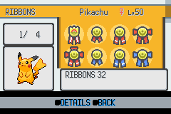
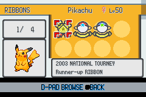
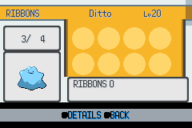
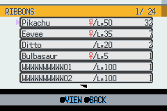
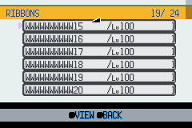
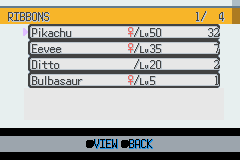

# HGSS ribbon interface — visual acceptance

Scope: the PokéNav ribbon **owner list and summary** on `feature/gen4-ui-renderer`.
The title, medal case, portrait/index cards and detail panel now use original
HGSS source cells. The four-by-two grid and native 32×32 ribbon art fit the
GBA screen. Source mapping and palette/VRAM ownership are documented in
[the background trace](hgss_ribbon_bg_trace.md).

## Reviewed native framebuffer captures

These are unscaled 240×160 mGBA frames from the real PokéNav menu, not
offline artwork previews. Captured and reviewed on 2026-11-03.

The review checked normal/gift icon colors, selection alignment, both
lines of descriptions, title/name/gender/level, list index, portrait, count,
help bar and palette restoration after returning to the owner list.
The first capture exposed the help bar covering y=128 onward; the layout
now keeps all content above that boundary. Selection-corner opaque pixels
now stay inside the 32×32 icon cell instead of crossing into descriptions.

## Reproducible checks

The [live screenshot workflow](../../.github/workflows/hgss-ribbon-live-pokenav.yml)
patches only its disposable checkout to cold-boot the normal PokéNav main
menu, enter the real owner list, and drive the real summary with A/B/D-pad
input. It uploads screenshots, never its temporary ROM or save.

| Fixture/state | Verification |
|---|---|
| 25 normal + 7 gift ribbons | Five-page navigation, normal/gift boundary, expand/shrink |
| Seven gifts only | Starts at the gift row, no invented normal icon, expand/shrink |
| Empty summary | Zero count, empty grid, A leaves grid/details unchanged |
| One normal ribbon | One icon, count, expand/shrink |
| Owner switching | Name, gender, level, portrait, count and page reset |
| Exit/re-entry | Owner list works and original panel colors return |

The empty fixture is deliberately removed from its synthetic Pokémon
**after** owner-list construction, because the normal list excludes
ribbonless Pokémon. It does not change normal game or save behavior.

The automated verifier compares **404 opaque Champion pixels** and
**3,712 unobscured background pixels per settled screen** against the
source assets (RGB555 expansion tolerance of 8). Background comparisons
cover six settled states, including empty, single, gifts and re-entry.
It also rejects missing transitions and changes after A on an empty grid.

`check_hgss_ribbon_grid.py` validates all 32 ribbon/member/palette mappings,
all 207 nonempty ownership layouts, and the actual opaque selection-corner
footprint. `test/pokenav_ribbons.c` exercises the actual C navigation and
shared cursor centers, and measures both description lines for every
normal and gift ribbon against the available 140-pixel text width.

The separate [isolated icon workflow](../../.github/workflows/hgss-ribbon-emulator.yml)
still checks all five pages against original icon pixels in mGBA.

## Legacy cleanup

After live review and a repository-wide reference audit, the superseded
Emerald `summary_bg.png/.bin`, `icons.png`, `icons_big.png`, five icon
palettes and `mon_info.pal` are removed, along with the unused global
summary background declarations/definitions. The empty transparent grid window is
removed; text now overlays the original panels without overwriting them.

## Ribbon owner list — completed 2026-11-04

The owner picker now reuses the same verified retail HGSS summary header,
party-card corners/edges and palette. HGSS has no PokéNav ribbon owner list;
this is an adaptation of original cells, with no synthetic card artwork,
scaling or recoloring. The six visible 200×16 rows occupy x=24–223,
y=24–119, leaving both scroll controls and the shared help bar usable.

`make_hgss_ribbon_list.py` reproduces every output byte from the verified
summary cells and audits the live VRAM allocations. The first scrolling
capture exposed rows bleeding through transparent header windows. Header
text now has its own BG3 map; the original BG1 artwork masks BG2's circular
row buffer outside the six-row viewport. BG3 is hidden by the normal
summary/main-menu entry paths. Palette banks 1 and 7 are reloaded on entry.

The live fixture adds twenty boxed Unown, each with a distinct 12-character
nickname and level 100, after the four party owners. The third main-menu
entry removes only those synthetic box records to test a four-owner list.
These changes exist only in the disposable screenshot build.

`verify_hgss_ribbon_list_screens.py` compares **26,544 pixels per state**
against original panel tiles and the game's font glyphs, including the exact
expected nickname, level, ribbon count and selected/total index. Ten settled
states cover first/second/fourth pages, the last-entry boundary, upward
buffer wrap, return from a boxed summary, page-up to the start, main-menu
re-entry and a short list. Animated pointer footprints are excluded from
pixel comparisons and reviewed visually. The short list also proves that
unused rows contain no stale text or cards.

After live acceptance, `graphics/pokenav/ribbons/list_bg.png`, `list_bg.bin`
and `list_ui.pal` are removed. The hand-drawn counter card, row borders,
count pockets and alternating ticks are removed from runtime code. The
existing authenticated HGSS list pointer/scroll sprites remain in use.

This completes the GBA-adapted ribbon owner-list and summary interface.
Unrelated PokéNav screens and the overall Gen 4 migration remain separate.
